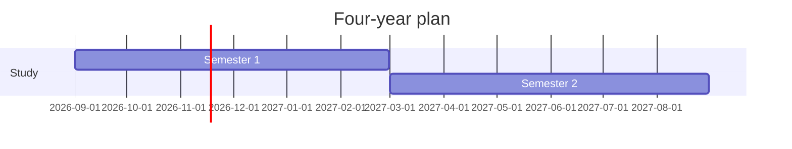

# dsh-docdesk · 资料区

An **add-only multi-format materials library** for DeepSeek Harness. The library starts empty: you pick the files that matter from your workspaces — Markdown notes and reports, text and code, HTML exports, chart images and screenshots, PDFs, audio and video — place their icons on a fixed non-overlapping desktop grid, marquee-select several at once, and open them full-screen with browser-style tabs. Markdown renders GFM tables, `chart` blocks and Mermaid diagrams inline; every other format gets its own viewer.


## Why

DSH agents write notes, plans, research and reports as `.md` files, and their work often leaves other artefacts beside them: exported HTML reports, chart images and screenshots, PDFs, audio and video. The files stay in the workspace, but the conversation that produced them scrolls away. 资料区 keeps the files you choose in one place without turning your whole workspace into a list:

- Nothing is imported automatically. You decide what enters the library, and the picker only offers formats a browser can preview — Markdown, text/code, HTML, images, PDF, audio and video. Office documents, archives, fonts and unknown binaries are left alone.
- Icons sit on a fixed desktop grid. Two icons never share a slot; icons can be placed anywhere in the visible first screen, and the desktop only grows or scrolls after that first screen is full.
- Anything you add opens full-screen with tabs, in a viewer that fits its format, not a cramped side drawer.

The plugin never moves, renames or deletes anything on disk.

## Features

- **Add files explicitly.** The **Add files** button opens a workspace picker with search, type filters and multi-select. Every previewable format is listed; entries already in the library are marked and cannot be added twice.
- **Type-aware library.** Each entry shows a format icon on the desktop grid and on its document tab. Picker rows carry a type chip, and filter chips beside the search box narrow the list to All / Documents / Images / Web / PDF / Media / Other.
- **Add from a file card.** A delivered file card gains an **Add to library** action; right-clicking the card opens a small menu with the same action. When the file's format cannot be previewed in a browser, the action reports it as unsupported instead of adding it. If your host does not render deliverable file cards, the picker is always available.
- **A fixed, non-overlapping desktop grid.** Icons snap to slot positions inside the desktop frame. Dropping a file onto another inserts it before/after that icon; dropping between two icons inserts in the gap. Folder-over-folder drops swap positions. New icons fill the first free slot. Before the first screen is full, any visible slot can be used; once it is full, adding another icon opens a new row and the desktop scrolls.
- **Marquee selection and bulk actions.** Hold the right mouse button and drag on empty desktop space to draw a selection box. Drag any selected icon to move the whole selection as a grid block. Remove the selection with <kbd>Delete</kbd> / <kbd>Backspace</kbd>, the selection pill in the toolbar, or the right-click menu. A multi-selection can also be put into a folder at once: right-click a selected item and choose a destination under **Put N items into**, or drag the selection onto a folder icon. The files on disk are never touched.
- **Markdown charts.** Fenced `chart` blocks are rendered into SVG bar, line, area, pie and donut charts. Data can be JSON or simple `label,value` lines. Rendering is local and does not execute arbitrary code.
- **Mermaid diagrams and GFM tables.** Fenced `mermaid` blocks render through a bundled Mermaid 12.2.0 runtime: Gantt timelines, `xychart-beta` charts, flowcharts, sequence/class/state/ER diagrams and more. GitHub-style pipe tables render as real tables. Mermaid is lazy-loaded from the plugin host, not a CDN, and runs with its strict security level.
- **Virtual folders.** Create folders and drag files or folders onto a folder icon. Folder badges show how many items are inside. Folders can be nested.
- **Rename anything.** Use the context menu or <kbd>F2</kbd>. The label in the library changes; the file on disk does not.
- **Full-screen reading with tabs and per-type viewers.** Double-click an entry to open it full-screen. The top row is a browser-style tab strip with a Home tab and one tab per open file, each carrying its format icon; tabs can be switched and closed. Markdown keeps the rich renderer, text/code opens in a monospace reader, HTML in a sandbox, images fit the window, PDF uses the browser viewer, and audio/video play in native players.
- **Immersive reading — from the library or a document.** On the home page click **沉浸 / Immersive** in the toolbar, or in a document click the expand icon in the path bar; press <kbd>F</kbd> as a shortcut. The panel becomes a fixed 100vw × 100vh layer at z-index 9999. The host sidebar is collapsed through `layout.toggleSidebar()` and native Fullscreen is requested when available; a native fullscreen exit is synchronized with the plugin state. Press <kbd>Esc</kbd> or the floating **Exit immersive** button to leave; the sidebar state, scroll locks and panel geometry are restored. Switching to the Home tab while immersive keeps the mode active. Immersive mode keeps the same number of icons per row as the normal desktop while spreading the columns wider; leaving it restores the exact normal positions.
- **Reading bookmarks, persistent last-read bar and line tags (Markdown).** The fixed reading bar above the document shows the last-read percentage, time and section, with **Resume reading**; it stays visible while scrolling and while the bookmark panel is open. The bookmark button lives at its right edge, directly under **Add files**, with a visible **Bookmarks** label. Click it or press <kbd>B</kbd> to add the current position. A rail left of the scrollbar marks the last-read position and every bookmark; hover or wheel over it for details. Right-click a rendered line to insert a bookmark there; jumping holds a theme-aware highlight for three seconds, then slowly fades it. Plain text/code also records the last-read position and shows the bar, but has no line bookmarks or highlights.
- **Breadcrumb paths and path drops.** Library breadcrumbs use chevron arrows, wrap before the search field and stop at two lines; deeper paths scroll vertically. While dragging, moving out of the top of the desktop opens a path-only drop mode with large, spaced crumb segments; the current folder is marked, hovering highlights a segment and releasing moves the selection there. Drag toward the left/right edge or all the way down to the bottom edge to leave that mode without dropping; moving down partway does not close it.
- **Drag, insertion, folder swap and folder previews.** Dragging moves only the grabbed icon or selected group. The grabbed icon keeps the exact grab offset under the pointer; multi-select followers rush behind it and fade out, staying hidden until the drop, then immediately appearing at their committed positions. Other icons stay exactly where they are until the drop is committed. The drop cell follows the nearest slot under the pointer, not the dragged icon's centre, so grabbing an icon off-centre does not shift the target into the next row. The grid targeter uses a pointer-first floor calculation with an 8px snap threshold and 0.14 boundary hysteresis; when the pointer leaves the grid it falls back to the icon rectangle's overlap ratio (minimum 0.35). Grid lines, the candidate-cell outline and the pointer point are shown while dragging; the textual R/C/reason/overlap label is intentionally not shown. Dropping into an actual empty cell moves only the dragged group and leaves the other icons untouched. Dropping at the insertion caret between icons pushes only the icons in the way: a free slot behind absorbs the shift, and when the run is packed the blocking icons are carried along the chain until there is room. Multi-selection drops always occupy consecutive slots and never skip over icons sitting at the right row edge. Folder context menus can **Dissolve folder**, promoting direct files and child folders, or **Delete folder**, which removes the folder tree and moves its files back to the parent folder without touching the files on disk. New files added into a folder highlight once and fade. Files and folders moved into a folder, or released by dissolving/deleting one, get a persistent highlight that clears only when you leave that folder.
- **Hidden sidebar arrow.** A barely visible arrow sits at the middle of the left screen edge; hover it to show it, then click to collapse or expand the host sidebar. It uses the host's own sidebar toggle; the arrow direction follows the current sidebar state.
- **Search and remove.** Filter the current page by label or path; remove an entry from the library without touching the file.
- **Bilingual UI and theme-aware styling.** Chinese and English follow the Harness locale; colors come from the host theme tokens.


## Formats and viewers

Only formats a browser can render are offered. Office documents, archives, fonts and unknown binaries are not listed by the picker, and the file card's **Add to library** action reports them as unsupported. Text previews (Markdown and text/code) are capped at 2 MB.

| Kind | Formats | Reader |
| --- | --- | --- |
| Markdown | `.md` `.markdown` `.mdx` `.mdown` `.mkd` | The full Markdown renderer: GFM tables, `chart` blocks, Mermaid diagrams, bookmarks and the last-read bar. |
| Text and code | `.txt` `.log` `.csv` `.tsv` `.json` `.jsonc` `.jsonl` `.ndjson` `.yaml` `.yml` `.toml` `.ini` `.cfg` `.conf` `.properties` `.xml` `.sql` `.graphql` `.gql` `.rst` `.tex` `.srt` `.vtt` | A monospace scrolling reader. |
| HTML | `.html` `.htm` `.xhtml` | A sandboxed iframe in the reading pane. Inline CSS/JS runs; fetch/XHR requests, form submits and top-level navigation are blocked. |
| Images | `.png` `.jpg` `.jpeg` `.jfif` `.gif` `.webp` `.bmp` `.svg` `.ico` `.avif` `.apng` | Fit to the window, with a one-click switch to actual size. |
| PDF | `.pdf` | The browser's built-in PDF viewer. |
| Audio | `.mp3` `.wav` `.ogg` `.oga` `.m4a` `.aac` `.flac` `.opus` `.weba` | A native player. |
| Video | `.mp4` `.webm` `.ogv` `.mov` `.m4v` | A native player. |
| Extensionless | `README` `LICENSE` `NOTICE` `Makefile` `Dockerfile` `Gemfile` `Procfile` `Rakefile` `Justfile` | Treated as text. |

Common source files are accepted as text too: `.js .mjs .cjs .jsx .ts .tsx .css .scss .sass .less .vue .svelte .astro .py .pyi .rb .php .java .kt .kts .c .h .cc .cpp .cxx .hpp .hh .cs .go .rs .swift .m .mm .scala .clj .cljs .lua .pl .pm .r .jl .dart .ex .exs .erl .hrl .fs .fsx .vb .pas .asm .s .sh .bash .zsh .fish .ps1 .psm1 .bat .cmd .ipynb`.

An HTML file with an `assets/` folder works: the reading pane requests sibling CSS, JS and images from the same workspace folder through a workspace-confined site route, so an exported report renders as it was written. Access stays inside that workspace root; fetch/XHR requests, form submits and top-level navigation are still blocked.

Reading state follows the format. Markdown keeps bookmarks, line highlights and the last-read bar; plain text records the last-read position and shows the bar but has no line bookmarks. Images, HTML, PDF, audio and video open as plain viewers.

## Install

Requires **DSH 0.2.2-rc.1 or newer**.

### From the plugin market

Once the entry is merged into [awesome-dsh-plugin](https://github.com/awesome-dsh-plugin/awesome-dsh-plugin), open **Plugins → Discover**, search for **资料区** or **Materials**, and install it. The market installs from this repository; npm publication is optional.

### From GitHub

```sh
dsh plugin --profile <your-profile> add https://github.com/Velestia-star/dsh-docdesk
```

In DSH Desktop you can also open **Plugins → Add** and paste the repository URL. The bundle is a source package: the root `package.json` declares `dsh.bundle` and `cordis.patch.yml`.

### If the install stalls on a registry warning

Warnings such as `GET https://mirrors.cloud.tencent.com/npm/... error (UND_ERR_DESTROYED)` come from pnpm resolving **other plugins already in the profile**, not from this package: `dsh-docdesk` has no npm dependencies. The retries can succeed; if they do not, point the profile at a reachable registry and retry.

```sh
# either set it for this shell/profile...
dsh plugin --profile <your-profile> add https://github.com/Velestia-star/dsh-docdesk --registry=https://registry.npmmirror.com
# ...or set the default used by the desktop plugin manager:
npm config set registry https://registry.npmmirror.com
```

`https://registry.npmjs.org` works as a fallback. If an earlier attempt was interrupted, remove the half-installed entry first:

```sh
dsh plugin --profile <your-profile> remove dsh-docdesk
dsh plugin --profile <your-profile> add https://github.com/Velestia-star/dsh-docdesk --registry=https://registry.npmmirror.com
```

If `npm` is unavailable, put `registry=https://registry.npmmirror.com` in `%USERPROFILE%\.npmrc` (Windows) or `~/.npmrc`. The same mirror choice is available in the DSH Plugin Hub settings.

After installation, refresh the browser tab once so the client plugin loads.

When upgrading from an older version (for example to 0.4), if images, HTML, PDF or media do not appear in the picker, **fully quit and reopen DSH Desktop**: a page refresh only reloads the client half, while the Host half changes only when the host process restarts. After the restart, use **Retry** on a document's error card instead of closing and reopening its tab.

## Use

- Open **资料区** in the left sidebar.
- Click **Add files** (top-right). Search or narrow the list by type, tick one or more files, then click **Add selected**.
- Drag an icon to move it; it snaps to a fixed slot. Dropping it onto another file inserts before/after it, and dropping between icons inserts in the gap. A white insertion caret with split ends appears at the gap while dragging. Folder-over-folder drops swap. New icons fill the first free slot. You can drop icons anywhere in the visible first screen; a new row and scrolling appear only after the screen is full.
- Hold the **right mouse button** on empty desktop space and drag to marquee-select icons. Drag any selected icon to move the whole group, or press <kbd>Delete</kbd> / use the selection pill to remove the group from the library (files on disk stay). With a multi-selection, right-click a selected item and choose a folder under **Put N items into**, or drag the selection onto a folder icon, to move all selected items into it.
- Drag a selection upward out of the desktop to enter path-drop mode; hover a large breadcrumb segment and release. Drag one folder onto another to swap them; hold it there and right-click to put it inside instead. A folder's context menu offers **Dissolve folder** to promote its contents.
- **New folder** creates a folder in the current page. Drag a file onto a folder icon to file it; double-click the folder to open it.
- Right-click an icon for **Open, Rename, Copy path, Move to folder** and **Remove from library**. Folders also offer **Delete folder**, which moves their files back to the parent instead of deleting files.
- Double-click an entry to open it full-screen; each format picks its reader: Markdown renders in place, text/code opens in a monospace reader, HTML previews in a sandbox and pulls sibling assets from its own folder, images fit the window (click to switch to actual size), PDF opens in the browser's viewer, and audio/video play in native players. The path bar copies the path, reloads, downloads the original file, and — for non-text viewers — opens it in a new tab. Use the **资料区** tab to return to the desktop, click another tab to switch files, and use the × on a tab to close it.
- From the library home page (toolbar **沉浸 / Immersive**) or a document (path-bar expand icon), press <kbd>F</kbd> to enter immersive reading. Press <kbd>Esc</kbd> or the floating **Exit immersive** button to return; the host sidebar and layout snap back.
- In a Markdown document, press <kbd>B</kbd> or use the bookmark button in the fixed reading bar to bookmark the current position. Hover the rail left of the scrollbar for bookmark details; right-click a line to insert a bookmark there. The bookmark panel lists the automatic last-read position and every bookmark; click an entry to jump, and use **Edit** / **Delete** to manage it.
- On first use, the library seeds a concise **DocDesk guide** document. The guide is updated with new releases; removing it does not re-add it.
- The middle-left handle toggles the sidebar. The host collapses it to its icon rail; click the handle again to restore it.


## Charts

Fence a code block with `chart` (or `chart:bar`, `chart:line`, `chart:area`, `chart:pie`, `chart:donut`) and the reader renders it as an SVG chart. JSON is the most explicit form:

````markdown
```chart
{
  "type": "bar",
  "title": "Weekly documents",
  "unit": "docs",
  "data": [
    { "label": "Mon", "value": 3 },
    { "label": "Tue", "value": 5 },
    { "label": "Wed", "value": 4 }
  ]
}
```
````

Simple `label,value` lines work too:

````markdown
```chart:line
W1,2
W2,4
W3,3
```
````

The chart is drawn by the client from the block's data; no external script, network request, or user code is executed. An unparsable chart block shows the raw code with a short note.


## Mermaid diagrams

Fence a block with `mermaid` and the reader renders it with the bundled Mermaid runtime. Gantt timelines, `xychart-beta`, flowcharts, sequence diagrams, class/state/ER diagrams and the other Mermaid kinds are supported by Mermaid 12.2.0.

````markdown

````

The Mermaid bundle is vendored in `vendor/mermaid.min.js` (MIT) and served from the plugin host at `/api/dsh-docdesk/mermaid.js`; it is loaded only when a Markdown document contains a Mermaid block, and no CDN or external network request is involved. Mermaid runs with `securityLevel: 'strict'`. Wide Gantt timelines scroll horizontally inside their figure; xycharts size to their content so axis labels stay visible.

GFM pipe tables in the Markdown are rendered as real tables too, with optional `:---`, `:---:` and `---:` alignment.

## How it works

The bundle has two halves:

- **Host half** (`index.js`) scans registered workspaces, the profile's default working directory and live agent working directories for previewable files — Markdown, text/code, HTML, images, PDF, audio and video. It serves them through read-only routes:
  - `GET /api/dsh-docdesk/list` — candidate files for the picker, each with its kind
  - `GET /api/dsh-docdesk/read?path=<absolute path>` — one text file's content (2 MB cap)
  - `GET /api/dsh-docdesk/file?path=<absolute path>` — raw bytes for a whitelisted file; supports HTTP `Range` for audio/video seeking, and `download=1` for an attachment response
  - `GET /api/dsh-docdesk/site/<rootToken>/<relative path>` — an HTML file's sibling assets (CSS, JS, images) from the same workspace root; `<rootToken>` is the base64url-encoded workspace root id
  - `GET /api/dsh-docdesk/resolve?sessionId=…&seq=…&index=…` — resolve a delivered file card's durable coordinates to a path
  - `GET /api/dsh-docdesk/mermaid.js` — the bundled Mermaid runtime
- **Client half** (`client.js`) registers the **资料区** sidebar entry, the panel, the middle-edge sidebar handle and the delivered-file action. It renders the desktop, the picker, folders, the tabbed reader and the per-type viewers: Markdown renderer, monospace text reader, sandboxed HTML frame, image, PDF, audio and video.

Data and limits:

- The library (files, display names, folders, positions, open tabs) is stored in the browser under `dsh-docdesk.library.v2`; it is per browser profile and is not synced between devices.
- The files themselves remain the source of truth. If a file is moved or deleted outside the plugin, opening it reports the error and lets you remove the entry.
- Marquee selection, group dragging and bulk removal are client-side state only. Removing an entry from the library never deletes or moves a file.
- `chart` code blocks are parsed and drawn locally as SVG. Only the block's data is used; no arbitrary JavaScript, external chart library or network request is involved.
- Mermaid diagrams are rendered by the vendored Mermaid 12.2.0 bundle, served by the host route `/api/dsh-docdesk/mermaid.js` and lazy-loaded only when a `mermaid` block is opened. The runtime uses Mermaid's strict security level; diagram code is not executed as JavaScript.
- GFM pipe tables and the two fenced-block formats are handled by the client-side Markdown renderer; no extra document preprocessing is written back to disk.
- HTML previews run in a sandboxed iframe. The host serves HTML and SVG with `Content-Security-Policy: sandbox`, `connect-src 'none'` and `form-action 'none'`, so inline styles and scripts work while fetch/XHR requests, form submits and top-level navigation do not. Relative assets are reachable only inside the HTML file's own workspace root through `/api/dsh-docdesk/site/...`.
- Every route sits behind the same loopback / paired-device fence used by the bundled management pages and rejects forwarding headers. Requests are confined to scanned workspace roots, only whitelisted extensions are served, paths containing hidden dot-segments are rejected, and text previews are capped at 2 MB.
- The scan skips `node_modules`, `.git`, build output and virtual environments. Current caps are 3,000 files per scan, 4,000 directories per workspace, 16,000 directories in total and 6 levels of depth. Image, audio, video and PDF candidates are additionally capped at 1,200 items so media cannot crowd documents out of the picker.
- Bookmarks and line highlights stay Markdown-only; plain text keeps the last-read position and bar but has no line bookmarks. Images, HTML, PDF and media are plain viewers.
- The sidebar handle calls the host's `layout.toggleSidebar()`. The collapsed state is the host's rail, not a custom zero-width column.

## Screenshots

| Panel | Add files | Full-screen document |
| --- | --- | --- |
|  |  |  |

| Folder | Sidebar entry |
| --- | --- |
|  |  |

| Charts |
| --- |
|  |

## Project layout

```text
dsh-docdesk/
├── index.js              # Host half: scan, read, raw files, HTML site assets, resolve
├── client.js             # Browser module: sidebar entry, panel, tabs, picker, per-type viewers, file action
├── cordis.patch.yml      # Bundle patch that mounts the plugin row
├── package.json          # Manifest: dsh.bundle, dsh.client, exports, files
├── locale/
│   ├── en.json           # Plugin manager metadata (English)
│   └── zh.json           # Plugin manager metadata (Chinese)
├── icon.svg              # Bundle icon (used by the plugin manager)
├── vendor/               # Vendored Mermaid runtime and its MIT license
├── screenshots.json      # Market screenshot list
├── docs/
│   ├── icon.png          # Raster icon used by the market listing
│   ├── market-entry.yml  # Registry entry submitted to awesome-dsh-plugin
│   └── screenshots/      # README and market screenshots
├── CHANGELOG.md
├── LICENSE
├── README.md
└── README.zh.md
```

## Development

There is no build step. `index.js` is a plain ESM Cordis plugin; `client.js` is a browser module registered through `window.__ModuleLoader__.load` with the package name as its id. Edit either file, then refresh the browser tab. For a host-half change, reinstall the bundle (or restart the host) so the new module generation is loaded.

```sh
dsh plugin --profile <your-profile> add /absolute/path/to/dsh-docdesk
```

The only runtime imports are Node built-ins (`node:fs`, `node:path`) on the host and `react` from the host module table on the client. There are no npm dependencies to install.

## License

MIT. See [LICENSE](LICENSE).

---

[中文说明](README.zh.md)
