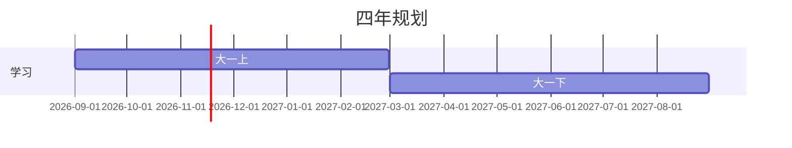

# dsh-docdesk · 资料区

一个**只收你主动加入**的 Markdown 资料区。资料区默认是空的：从工作区挑选真正要留的文档，在固定网格桌面内对齐摆放（图标不会重叠），右键框选后可以整组拖动，点开就全屏阅读；顶部用浏览器式标签页切换，GFM 表格、`chart` 代码块和 Mermaid 图都会在阅读器里直接渲染。


## 为什么

DSH 的智能体会把笔记、方案、调研和报告写成 `.md` 文件。文件留在工作区里，但生成它的那段对话会越滚越远。资料区只收你选中的文档，不会把整个工作区变成一长串列表：

- 不自动导入，由你决定什么进入资料区。
- 图标落在固定网格上，两个图标不会共享一个格子；首页的可见格子可以随便放，只有首页放满后，再加文件才会向下开一行并滚动。
- 文档以全屏阅读器打开，并用标签页切换，不再挤在侧边抽屉里。

插件不会移动、重命名或删除磁盘上的任何文件。

## 功能

- **主动添加文件。** 右上角「添加文件」打开工作区选择器，支持搜索和多选；已在资料区里的文档会标记为「已加入」，不会重复添加。
- **从文件卡片加入。** 生成文件的卡片上会出现「放入资料区」按钮；右键文件卡片也会弹出同样的菜单。如果当前宿主不渲染文件卡片，用选择器添加即可。
- **固定网格桌面。** 图标会对齐到桌面框内的固定格子；拖到另一个文件上会在它前面或后面插入，拖到两图标之间会在间隙插入；文件夹拖到文件夹上交换位置。新图标填入第一个空格。首页没满时，可见的任意格子都能放；首页放满后再加图标，才会向下开新行并滚动。
- **右键框选 + 批量操作。** 在桌面空白处按住右键拖动，画出选择框；拖动任意一个选中的图标，整组按相对位置移动。选中后按 <kbd>Delete</kbd> / <kbd>Backspace</kbd>、点工具栏的「已选 N 项」或右键菜单，都能把整组移出资料区；磁盘文件不会被删除。选中多份后也可以在右键菜单里选择「把 N 项放入文件夹」，或者直接把整组拖到文件夹图标上，一次性归档。
- **Markdown 图表。** `chart` 代码块会渲染成 SVG 柱状图、折线图、面积图、饼图或环形图；数据可以是 JSON，也可以是简单的「标签,数值」行。全部本地绘制，不执行任意代码。
- **Mermaid 图和 GFM 表格。** `mermaid` 代码块通过内置的 Mermaid 12.2.0 渲染：甘特图、`xychart-beta`、流程图、时序图、类图/状态图/ER 图等都能显示；GitHub 风格的管道表格会渲染成真正的表格。Mermaid 从插件宿主按需加载，不走 CDN，并启用严格安全级别。
- **虚拟文件夹。** 可以新建文件夹，把文档拖到文件夹图标上归类；角标显示文件夹里的项目数；文件夹可嵌套。
- **文件和文件夹都能重命名。** 右键菜单或 <kbd>F2</kbd>。改的是资料区里的显示名，不是磁盘文件名。
- **全屏阅读 + 标签页。** 双击文档全屏打开；顶部一行是浏览器式标签栏，有「资料区」主页标签和每个已打开文档的标签，可切换、可关闭。
- **沉浸阅读（主页和文档都能用）。** 在资料区主页点工具栏的「沉浸」按钮，或在文档路径栏点展开图标，也可以按 <kbd>F</kbd>；插件会变成固定在视口上的 100vw × 100vh 层（z-index 9999）。宿主侧栏通过 `layout.toggleSidebar()` 收起，浏览器支持时会请求原生全屏，原生全屏退出也会同步回插件状态。按 <kbd>Esc</kbd> 或点浮动的「退出沉浸」按钮即可退出，侧栏状态、滚动锁和面板几何都会恢复。从沉浸中的文档切回资料区主页，也仍然保持沉浸；沉浸模式保持和普通模式相同的每行图标数，同时把横向间距拉大，退出后回到原来的精确位置。
- **正文书签、固定阅读提示和行标签。** 文档顶部固定显示上次阅读的百分比、时间、章节和「继续阅读」，滚动或打开书签面板都不会消失。书签按钮在提示条右端，位于「添加文件」正下方，图标下面写着「书签」；点它或按 <kbd>B</kbd> 记录当前位置。右侧滚动条左边用横线标出上次阅读和所有书签，鼠标移过或滚轮经过会显示标题、百分比、时间和备注，点一下即可跳转。在正文里右键某一行可以就地在那一行插入书签；跳转时目标行保持高亮 3 秒，然后慢慢消失，明暗主题都适配。
- **面包屑路径和路径投放。** 资料区顶部路径用箭头连接，在搜索框前换行，最多显示两行；更深的路径在路径区域纵向滚动。拖动文件时把鼠标向上移出桌面，会进入只显示路径的投放模式：路径放大、间距拉开，当前文件夹标「当前」；鼠标移到路径上高亮，松开即可放入。进入后把鼠标拖到左右边缘，或一直向下拉到路径区域底部边缘，就会退出这个界面，不会投放到文件夹；向下没到底部不会退出。
- **拖动、插入、文件夹交换和文件夹预览。** 拖动时只移动抓取的图标或选中组，其他文件在松开前保持原位不动。抓取时图标保持鼠标按下的相对位置，不再强制把中心对准鼠标；整组拖动时其他选中项会迅速向被拖图标靠拢并隐藏，直到松开才立刻出现在最终位置。落点按鼠标所在位置判断，不再按被拖图标的中心判断，所以从图标边缘抓起时，鼠标过半进入哪一格就选哪一格，不会掉到下一行。网格判定使用指针落格、8px 吸附阈值和 0.14 边界滞回；指针离开网格后按图标矩形重叠比例回退（最低 0.35）。拖动时显示网格线、候选格边框和判定点，但不显示行/列、原因和重叠比例这些文字参数。拖到真正的空格时只移动拖动的文件，其他图标保持原位；拖到图标之间的插入标线时只推动挡路的图标：后面有空位就补到空位，连续排满没有空位时带着挡路的图标一起向后移，直到腾出位置。多选放下时整组始终占连续格子，不会跳过顶在行尾的文件。文件夹右键菜单可「解散文件夹」，把直接文件/子文件夹移到上一级；也可「删除文件夹」，删除文件夹树并把文档移回上一级，不删除磁盘文件。通过「添加文件」新放进文件夹的文件会高亮一次后淡出；拖进文件夹的文件/文件夹，以及解散或删除文件夹后放出来的条目，会一直保持高亮，直到离开当前文件夹才清除。
- **隐藏的侧栏箭头。** 屏幕左边缘正中间有一个几乎透明的小箭头；鼠标移过去才显示，点一下展开或收起侧栏。它调用宿主自己的侧栏开关，箭头方向随当前状态变化。
- **搜索与移除。** 按显示名或路径过滤当前页；把条目移出资料区不会碰文件。
- **中英双语、跟随主题。** 界面语言跟随 Harness，颜色取自宿主主题变量，自动适配明暗模式。


## 安装

### 从插件市场安装

等条目合并进 [awesome-dsh-plugin](https://github.com/awesome-dsh-plugin/awesome-dsh-plugin) 后，在 Harness 里打开 **插件 → 发现**，搜索 **资料区** 或 **Materials** 安装即可。市场直接从本仓库安装，npm 发布是可选的。

### 从 GitHub 安装

```sh
dsh plugin --profile <你的 profile> add https://github.com/wei238982377/dsh-docdesk
```

在 DSH Desktop 里也可以打开 **插件 → 添加**，粘贴仓库地址。这个 bundle 是源码包：根目录的 `package.json` 声明了 `dsh.bundle` 和 `cordis.patch.yml`。

### 安装卡在 npm 镜像警告时

出现 `GET https://mirrors.cloud.tencent.com/npm/... error (UND_ERR_DESTROYED)` 这类警告，是 pnpm 在解析 **当前 profile 里已有的其他插件**，不是这个插件在拉依赖：`dsh-docdesk` 本身没有 npm 依赖。多等几次重试有时会自己通过；如果一直失败，把 registry 换到可访问的镜像再重试。

```sh
# 只给这一次安装换源
dsh plugin --profile <你的 profile> add https://github.com/wei238982377/dsh-docdesk --registry=https://registry.npmmirror.com
# 或设置桌面插件管理器的默认源
npm config set registry https://registry.npmmirror.com
```

也可以改用 `https://registry.npmjs.org`。如果上一次装到一半失败，先移除再装：

```sh
dsh plugin --profile <你的 profile> remove dsh-docdesk
dsh plugin --profile <你的 profile> add https://github.com/wei238982377/dsh-docdesk --registry=https://registry.npmmirror.com
```

如果没有 `npm` 命令，可以在 `%USERPROFILE%\.npmrc`（Windows）或 `~/.npmrc` 里写 `registry=https://registry.npmmirror.com`。DSH Plugin Hub 的设置里也有同样的镜像选项。

装好后刷新一次浏览器标签页，客户端插件才会加载。

## 使用

- 点左侧 **资料区** 打开面板。
- 点右上角 **添加文件**：可以搜索，勾选一个或多个文档，再点 **加入所选**。
- 拖动图标换位置；松开后吸附到固定格子。拖到另一个文件上会在它前面或后面插入，拖到两图标之间会在间隙插入；插入时显示白色分叉标线。文件夹拖到文件夹上交换。首页的可见格子都能放；首页放满后再加图标才会开新行、出现滚动。
- 在桌面空白处按住**右键**拖动可以框选多个图标；拖动任意选中的图标会整组移动；按 <kbd>Delete</kbd> 或点工具栏的「已选 N 项」可把整组移出资料区（磁盘文件保留）。选中多份后，右键其中一个并选择目标文件夹，或把整组拖到文件夹图标上，就能一次全部放进去。
- 把选中的文件向上拖出桌面进入路径投放模式；把鼠标移到放大的路径段上松开即可。文件夹拖到另一个文件夹上默认交换；停住后点右键改为放入。文件夹右键菜单里有「解散文件夹」，会把内容移到上一级。
- **新建文件夹** 在当前页建文件夹。把文档拖到文件夹图标上就归进去了；双击文件夹进入，用面包屑或返回箭头回上一级。
- 右键图标可以 **打开、重命名、复制路径、移动到文件夹、从资料区移除**；文件夹还多一个 **删除文件夹**，删除后里面的文档会移回上一级，不会删除磁盘文件。
- 双击文档全屏打开。点 **资料区** 标签回主页，点其他标签切换文档，点标签上的 × 关闭。
- 在资料区主页点工具栏的「沉浸」，或在文档里点路径栏展开图标，也可以按 <kbd>F</kbd> 进入沉浸阅读；按 <kbd>Esc</kbd> 或点浮动的「退出沉浸」按钮返回，宿主侧栏和布局会恢复原状。
- 在文档里按 <kbd>B</kbd> 或点固定阅读提示条右端的书签按钮，把当前位置加入书签；滚动条左边的横线可以查看书签详情，正文里右键某一行也能插入书签。打开书签面板可以看到自动记录的上次阅读位置和全部书签，点条目跳转，用「编辑 / 删除」管理。
- 第一次使用时，资料区会自动放入一份简洁的「资料区使用说明」；以后更新插件会同步新功能，移出后不会再次自动加入。
- 左边缘正中间的隐藏箭头用来收起 / 展开侧栏；鼠标移过去显示，箭头方向随状态变化。


## 图表

把代码块标成 `chart`（或 `chart:bar`、`chart:line`、`chart:area`、`chart:pie`、`chart:donut`），阅读器就会把它渲染成 SVG 图表。最明确的是 JSON：

````markdown
```chart
{
  "type": "bar",
  "title": "每周文档数",
  "unit": "篇",
  "data": [
    { "label": "周一", "value": 3 },
    { "label": "周二", "value": 5 },
    { "label": "周三", "value": 4 }
  ]
}
```
````

也支持简单的「标签,数值」行：

````markdown
```chart:line
W1,2
W2,4
W3,3
```
````

图表由客户端根据代码块里的数据在本地绘制，不加载外部脚本、不发网络请求、不执行用户代码。解析失败时会显示提示并保留原始代码。


## Mermaid 图

把代码块标成 `mermaid`，阅读器就会用内置的 Mermaid 渲染。甘特图、`xychart-beta`、流程图、时序图、类图/状态图/ER 图等 Mermaid 12.2.0 支持的图都能显示。

````markdown

````

Mermaid 运行时放在仓库的 `vendor/mermaid.min.js`（MIT 许可），由插件宿主从 `/api/dsh-docdesk/mermaid.js` 提供；只有打开含 Mermaid 的文档时才加载，不走 CDN、不请求外网。运行时使用 `securityLevel: 'strict'`，图表代码不会被当作 JavaScript 执行。甘特图较宽时可在图内横向滚动；xychart 会按内容撑开，坐标轴标签不会被截掉。

Markdown 里的 GFM 管道表格也会渲染成真表格，支持 `:---`、`:---:`、`---:` 对齐。

## 工作原理

插件分两半：

- **宿主半**（`index.js`）扫描已登记的工作区、默认工作目录和活动智能体的工作目录，收集 `.md` / `.markdown` / `.mdx`，并提供三个只读接口：
  - `GET /api/dsh-docdesk/list` —— 选择器用的候选文件
  - `GET /api/dsh-docdesk/read?path=<绝对路径>` —— 单个文档内容
  - `GET /api/dsh-docdesk/resolve?sessionId=…&seq=…&index=…` —— 把生成文件卡片的坐标解析成路径
- **客户端半**（`client.js`）注册 **资料区** 侧边栏入口、面板、左边缘侧栏手柄和生成文件动作，负责桌面、选择器、文件夹和标签页阅读器。

数据与限制：

- 资料区数据（文档、显示名、文件夹、位置、打开的标签）存在浏览器的 `dsh-docdesk.library.v2` 里，按浏览器 profile 区分，不跨设备同步。
- Markdown 文件本身才是事实来源。文件在插件外被移动或删除时，打开会报错，并可以把它从资料区移除。
- 框选、整组拖动和批量移除都只是客户端状态；从资料区移除条目不会删除或移动磁盘文件。
- `chart` 代码块由客户端解析并本地绘制成 SVG，只使用代码块里的数据；不执行任意 JavaScript，不加载外部图表库，也不发网络请求。
- Mermaid 图由仓库内置的 Mermaid 12.2.0 渲染，宿主通过 `/api/dsh-docdesk/mermaid.js` 提供，只有打开 `mermaid` 代码块时才加载；运行时使用 Mermaid 的严格安全级别，图表代码不会被当作 JavaScript 执行。
- GFM 表格和两种代码块都由客户端 Markdown 渲染器处理，不会改写磁盘上的文档。
- list / read 接口使用与内置管理页相同的「仅本机 / 已配对设备」围栏，并拒绝带转发头的请求；读取范围限定在已扫描根目录内、只允许 Markdown 扩展名，单次预览上限 2 MB。
- 扫描会跳过 `node_modules`、`.git`、构建产物、虚拟环境等目录。当前上限是 3,000 个文档、每个工作区 4,000 个目录、总计 16,000 个目录、6 层深度。
- 侧栏手柄调用宿主的 `layout.toggleSidebar()`；收起状态是宿主的图标栏，不是自定义的零宽栏。

## 截图

| 面板 | 添加文件 | 全屏文档 |
| --- | --- | --- |
|  |  |  |

| 文件夹 | 侧边栏入口 |
| --- | --- |
|  |  |

| 图表 |
| --- |
|  |

## 目录结构

```text
dsh-docdesk/
├── index.js              # 宿主半：扫描、读取、解析生成文件坐标
├── client.js             # 浏览器模块：侧边栏入口、面板、标签页、选择器、文件动作
├── cordis.patch.yml      # 挂载插件行的 bundle patch
├── package.json          # 清单：dsh.bundle、dsh.client、exports、files
├── locale/
│   ├── en.json           # 插件管理器元数据（英文）
│   └── zh.json           # 插件管理器元数据（中文）
├── icon.svg              # bundle 图标（插件管理器使用）
├── vendor/               # 内置 Mermaid 运行时与 MIT 许可
├── screenshots.json      # 市场截图清单
├── docs/
│   ├── icon.png          # 市场条目用的位图图标
│   ├── market-entry.yml  # 提交给 awesome-dsh-plugin 的条目
│   └── screenshots/      # README 与市场截图
├── CHANGELOG.md
├── LICENSE
├── README.md
└── README.zh.md
```

## 开发

没有构建步骤。`index.js` 是普通 ESM Cordis 插件；`client.js` 是通过 `window.__ModuleLoader__.load` 注册的浏览器模块，id 等于包名。改完刷新浏览器标签页即可。宿主半改动需要重新安装 bundle（或重启宿主）来加载新的模块代际。

```sh
dsh plugin --profile <你的 profile> add /绝对路径/dsh-docdesk
```

运行时只依赖宿主内置：宿主侧是 `node:fs`、`node:path`，客户端侧是从宿主模块表取到的 `react`。没有需要安装的 npm 依赖。

## 许可

MIT，见 [LICENSE](LICENSE)。

---

[English](README.md)
